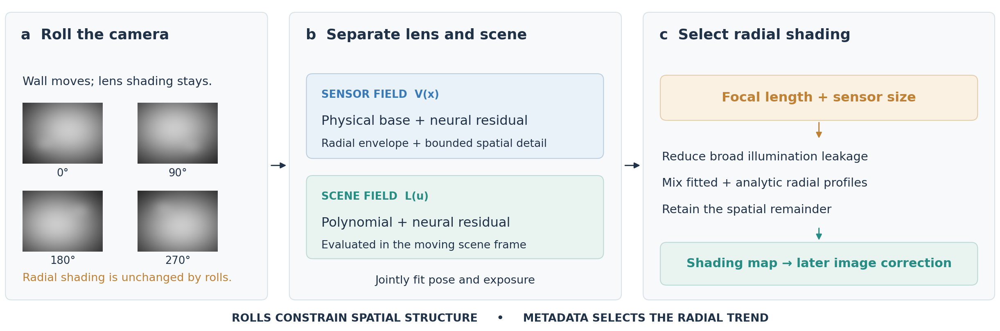

# Neural Grey

**Practical Vignetting Calibration from Casual Camera Rolls**

Neural Grey estimates a **reusable camera–lens shading map from four approximate
roll captures of a static, light-colored surface**. Rolling the camera moves wall
illumination across the sensor while lens shading stays fixed. The method fits
these two fields jointly, together with small pose and exposure errors, using a
physical shading envelope and compact bounded neural residuals.

The result is a calibration for one camera–lens–aperture–focus configuration.
Use the saved map to correct later linear images acquired at that configuration.



## How it works

1. **Capture:** take four images near 0°, 90°, 180° and 270° roll, viewing the same
   static, light-colored surface. Keep the images in sensor coordinates.
2. **Fit:** jointly estimate sensor-fixed shading, scene-fixed illumination,
   exposure and small geometric errors. A cosine-power envelope and bounded
   neural residual describe the shading; a polynomial and compact neural field
   describe illumination.
3. **Select the radial profile:** rolls leave radial attenuation unchanged, so
   they cannot fully distinguish radial lens shading from radial wall lighting.
   D2 stabilization reduces broad asymmetric leakage; the focal-conditioned
   radial selector uses focal length and sensor size to choose the broad radial
   profile while retaining the fitted spatial remainder.
4. **Reuse:** save the shading map and divide subsequent linear images by it.

The network is **trained from scratch on each four-capture set**. No pretrained
weights, external training dataset, lens-database query or ground-truth shading
map is required for calibration. Without focal metadata, the package returns
the D2-stabilized estimate.

## Install and try

Python 3.10+, PyTorch, NumPy and OpenCV. CPU and CUDA are supported.

```shell
git clone https://github.com/TomaKakuei/Neural-Grey.git
cd Neural-Grey
python -m pip install .
neural-grey demo --device cpu --output outputs/demo
```

The demo generates a small analytic four-roll example and runs two fitting
epochs. It exercises the full pipeline; it does not reproduce a paper benchmark.

## Fit your calibration

Prepare a linear-intensity array of shape `(4, H, W)`, ordered by roll angle
`[0, 90, 180, 270]`, with values in `[0, 1]`. Save it as `.npy`, or as an NPZ
array named `captures`. All four images must share the same sensor frame and size.

```shell
neural-grey fit captures.npz --focal-mm 28 --sensor-diag-mm 43.3 --device cuda --output outputs/my-lens
```

The default fit uses 200 epochs, batches of 8,192 coordinates and up to 240,000
sampled locations. It writes `calibration.npz`, a preview, a training summary and
a resumable `training.pt`. Training is the central implementation in this release.

```python
import numpy as np
from neural_grey import calibrate, Calibration

captures = np.load("captures.npy", allow_pickle=False)
calibration = calibrate(captures, focal_length_mm=28,
                        sensor_diagonal_mm=43.3, device="auto")
calibration.save("calibration.npz")

loaded = Calibration.load("calibration.npz")
corrected = loaded.correct(np.load("linear_image.npy", allow_pickle=False))
np.save("corrected.npy", corrected)
```

For Bayer RAW files, install the optional decoder and prepare the inputs directly:

```shell
python -m pip install ".[raw]"
neural-grey prepare-raw roll0.NEF roll90.NEF roll180.NEF roll270.NEF --output captures.npz
```

[Training and capture guide](docs/TRAINING.md) covers RAW preparation, coordinate
conventions, optimizer settings, checkpoint recovery and the Python API.

## Code and reported results

| Component | Implementation |
| --- | --- |
| Physical–neural shading and illumination fields | [`model.py`](src/neural_grey/model.py) |
| Joint losses, Adam fitting and training recovery | [`training.py`](src/neural_grey/training.py) |
| Four-roll preprocessing and coordinate sampling | [`preprocessing.py`](src/neural_grey/preprocessing.py) |
| D2 stabilization and continuous focal-conditioned selector | [`selector.py`](src/neural_grey/selector.py) |
| Portable maps and later image correction | [`calibration.py`](src/neural_grey/calibration.py) |

This release follows the current manuscript, *Neural Grey: Practical Vignetting
Calibration from Casual Camera Rolls*, by Yueze Wang and Spencer Smith.
The manuscript reports the following shading-map PSNR means:

| Evaluation | Reported PSNR |
| --- | --- |
| 100 synthetic cases | 25.43 dB |
| Ray-traced lens architectures | 24.49 dB |
| 21 real takes across 7 optical configurations | 25.38 dB |

These are existing manuscript results, not measurements from the short demo.
The [method notes](docs/METHOD.md) explain the representation, radial ambiguity,
release scope and practical limits. Full experimental datasets and local research
records are not bundled with this code release.

```shell
python -m unittest discover -s tests -v
```
